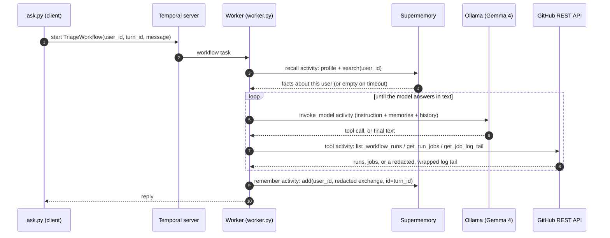
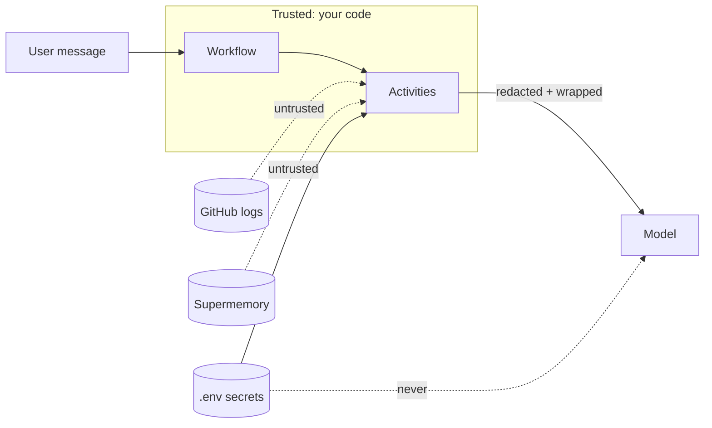

# Architecture

One question ("why did the latest run fail?") becomes one Temporal workflow. Everything that touches the outside
world (the model, Supermemory, GitHub) runs as an **activity**. The workflow only decides what happens next.

## The request, step by step

Every arrow that leaves the worker is an activity, so Temporal records it in the event history, retries it on
transient failure, and never re-runs it once it has completed.

## Where each concern lives

| Concern | File | What it does |
|---|---|---|
| Orchestration | [`workflow.py`](../workflow.py) | recall, then the ADK agent, then remember. Pure decisions, no I/O. |
| Model registration | [`worker.py`](../worker.py) | Registers Ollama under the alias `gemma4-ollama` and starts the worker. |
| Memory I/O | [`memory.py`](../memory.py) | `recall` and `remember` activities. The namespace is always `user_id`. |
| GitHub I/O | [`github_tools.py`](../github_tools.py) | Three read-only activities, the allowlist and the error mapping. |
| Safety helpers | [`safety.py`](../safety.py) | `redact` masks secrets, `wrap` labels text as untrusted data. |
| Client | [`ask.py`](../ask.py) | Starts a workflow and prints the reply. |

## The model path

ADK's `TemporalModel("gemma4-ollama")` turns each model call into an `invoke_model` activity. On the worker,
`OllamaGemma` (a small `LiteLlm` subclass) is registered under that alias and talks to Ollama through LiteLLM with the
`ollama_chat/` prefix. See [temporal-concepts.md](temporal-concepts.md#9-the-adk-plugin) for why the alias exists.

## Trust boundaries

- The GitHub token and the Supermemory key are read only inside activities. They never appear in workflow code or in
  text the model sees.
- Log text and recalled memories are **untrusted data**: they are wrapped in `<untrusted_*>` tags before the model
  reads them. See [safety.md](safety.md).
- The allowlist and the read-only guarantee are enforced in code, not in the prompt.

## What is deliberately not here

No guardrail framework, no tracing backend, no metrics stack, no config system. Temporal's UI and event history are
the observability. This keeps the agent small enough to read in one sitting.
