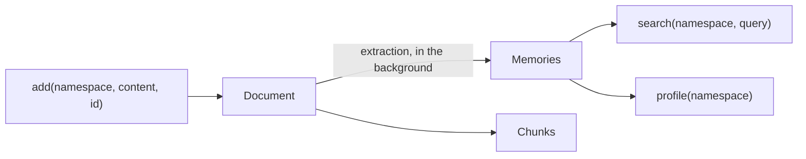

# Memory concepts (Supermemory)

An agent that forgets everything between conversations can't say "which repo did I ask about?". This doc explains how
the agent remembers, using the real calls in [`memory.py`](../memory.py). Run
[`demos/03_memory_basics.py`](../demos/03_memory_basics.py) to see each object described here.

## The mental model

| Term | Meaning | In this repo |
|---|---|---|
| **Namespace** | The isolation boundary. Every call takes it as the first argument. | `user_id`. One user, one namespace. |
| **Document** | What you write: here, one conversation turn. | `remember` adds `User: ...\nAssistant: ...` |
| **Memory** | A fact Supermemory extracts from documents. You never write one directly. | "Shubham mostly works on the devboard repo." |
| **Profile** | A maintained summary: `static` (durable) and `dynamic` (recent) facts. | `recall` reads both. |
| **Search** | Ranked lookup. `search_mode="memories"` searches facts, `"chunks"` searches raw text. | `recall` uses `"memories"`. |

Profile entries are objects with a `.memory` attribute, not plain strings. The SDK is v5 (`supermemory>=5`); older
releases target a different API.

## Recall: what the agent reads before answering

[`memory.py:15`](../memory.py) runs `profile` and `search` in parallel, de-duplicates the facts, and returns them as
a bullet list. The workflow puts that list into the model's instruction inside an `<untrusted_memories>` tag
([`workflow.py:36`](../workflow.py)). If recall fails or times out, the workflow continues with no memory instead of
failing the whole question.

## Remember: what the agent writes after answering

[`memory.py:25`](../memory.py) adds the redacted exchange with `id=turn_id`. Because the id is stable, Temporal can
retry the activity safely: a second `add` with the same id updates the same document instead of creating a duplicate.
Run demo 3 to see both calls return the same id.

## Tenant isolation

The model never chooses or sees the namespace, and there is no model-callable memory tool. A prompt injection can't
ask for "alice's memories" because the code, not the model, supplies `user_id`. The eval `tenant_isolation` and
[`demos/04_tenant_isolation.py`](../demos/04_tenant_isolation.py) check that user B never sees user A's facts.

## Memory is untrusted input

Anything stored today is read back into a prompt tomorrow, so a poisoned memory is a prompt injection with a delay.
Two defenses are in the code: memories are wrapped as untrusted reference data, and the instruction is passed to ADK
as a **callable** so ADK doesn't try to template `{braces}` inside recalled text. The eval `braces_in_memory` covers it.
Secrets are redacted **before** they are stored ([`safety.py`](../safety.py)).

## Extraction is lossy: a real failure we hit

After the agent answered "what failed recently on LondheShubham153/devboard-starter?", we asked "which repo did I ask
about?" and it replied "I do not have enough context". Recall itself worked (0.6 seconds, ten facts), but none of the
extracted memories contained the repo name. They were run-level facts such as "Run 36442250060 of workflow
.github/workflows/devops.yml on branch main failed on 2026-09-28". The extractor kept what it judged durable and dropped
the question's subject.

The same query in other search modes, on the same namespace:

| `search_mode` | Results mentioning the repo name |
|---|---|
| `"memories"` (what `memory.py` uses) | 0 of 5 |
| `"hybrid"` | 1 of 5 (the raw conversation chunk) |
| `"chunks"` | 1 of 2 |

So the raw text was stored and searchable; only the extracted memories lost it. Changing `recall` to
`search_mode="hybrid"` (and reading `r.memory or r.chunk`) would likely fix this class of question. We left the agent on
`"memories"` as originally specified and use a follow-up that memories can answer ("which failed run ids did you tell me
about earlier?") in the README. Try the change yourself, then re-run the follow-up.

## Timing: why recall sometimes comes back empty

Extraction happens in the background, controlled by the `dreaming` option on `add`:

| `dreaming` | Behavior | Use it for |
|---|---|---|
| `"instant"` | Extracts right away (costs one extra operation per document). | Tests, demos, anything that reads memories immediately. |
| `"dynamic"` (default) | Batches extraction. A new namespace can look empty for minutes. | Production, where a slight delay is fine. |

Set it with `SM_DREAMING` in `.env` ([`memory.py:29`](../memory.py)). Even with `"instant"`, memories took roughly
a minute to become searchable in our runs, and individual calls took anywhere from under a second to about 40 seconds.
Two consequences you will see in the code and logs:

- The recall timeout is tunable (`RECALL_TIMEOUT_S`, default 5). At 5 seconds recall often fell back to empty during
  testing.
- Calls on a namespace whose first document is still being processed can return `401`. The activities rely on
  Temporal's retries, and the demos poll until the memory is searchable.

## Production recommendations

- Keep `dreaming="dynamic"` and accept the delay; use `"instant"` only where the next step needs the memory now.
- Treat the recall timeout as a product decision: a short timeout favors latency, a longer one favors continuity.
- Keep redaction in front of every `add`, and keep the memory wrapped as untrusted when it reaches a prompt.
- Add your own graphs and dashboards on top of the Supermemory console; see [screenshots.md](screenshots.md).
